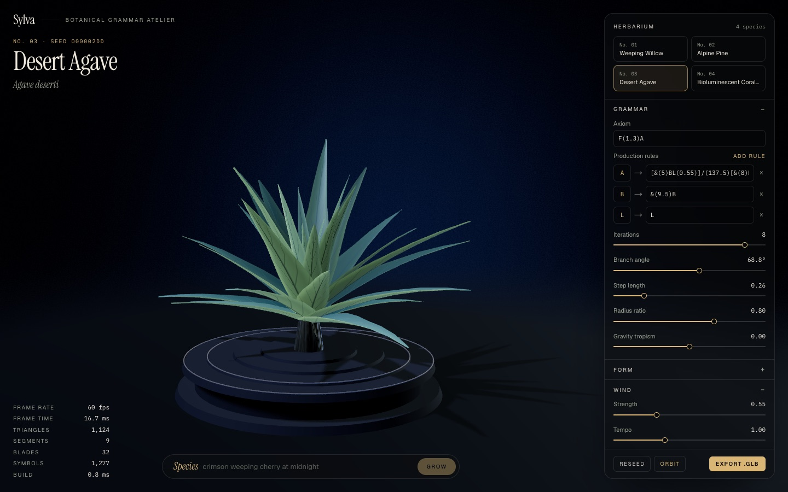
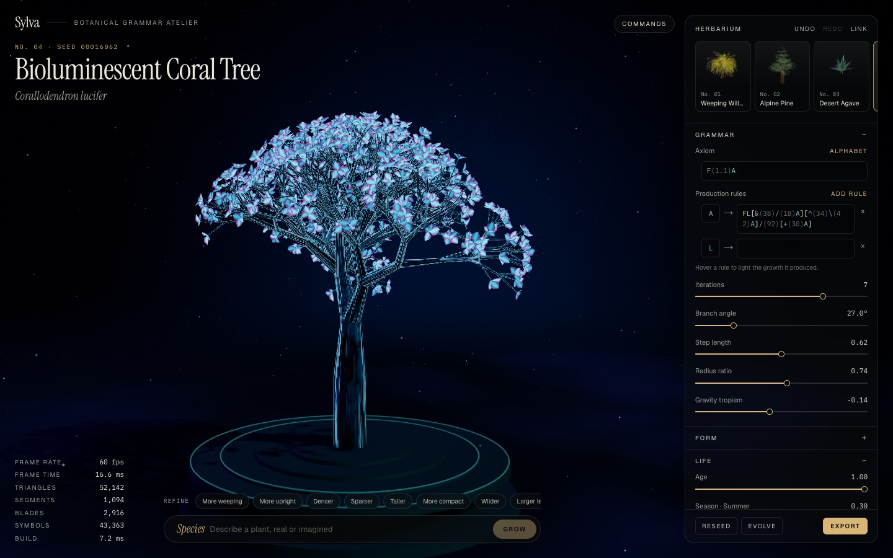
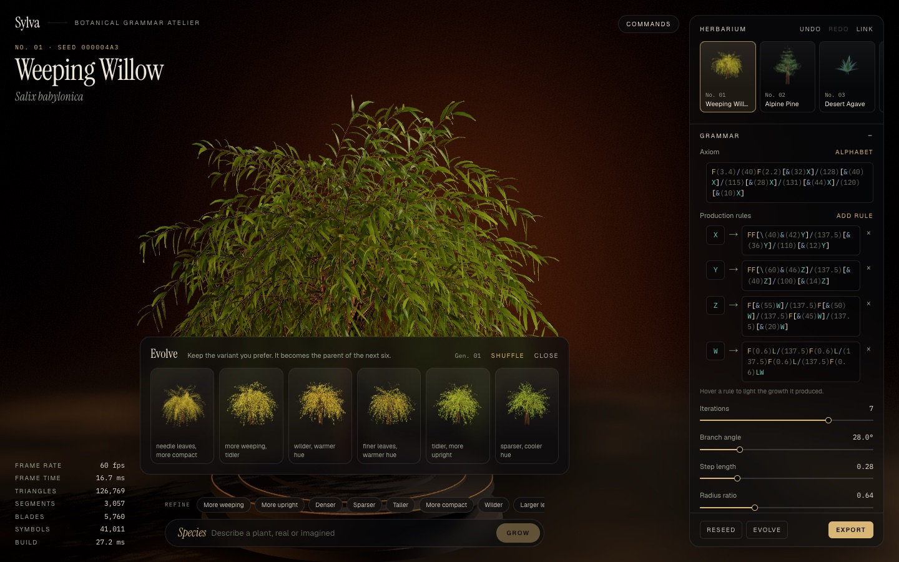
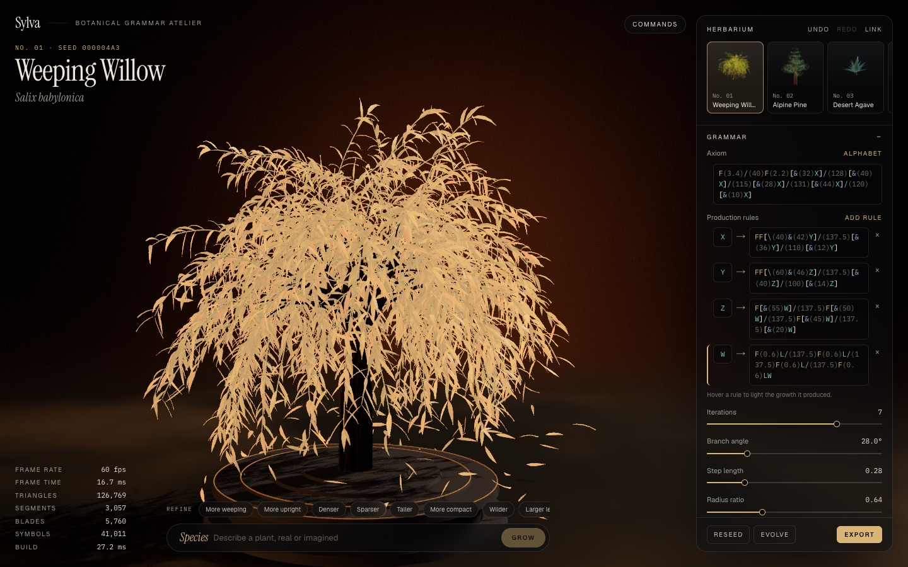
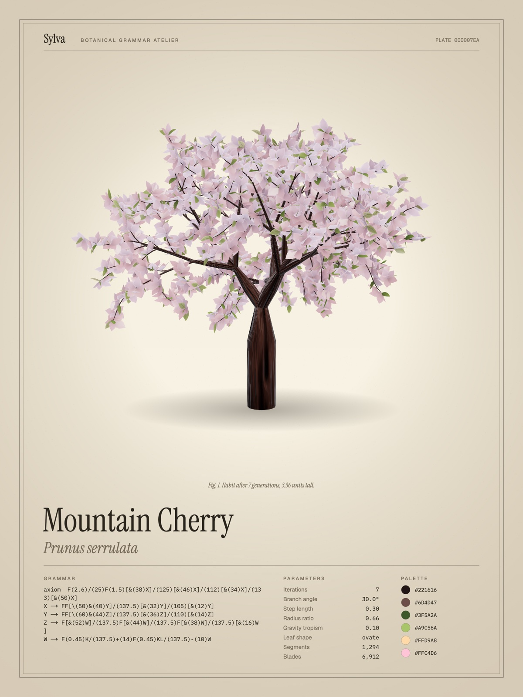

# Sylva

Sylva is an interactive atelier for growing plants from formal grammars. A bracketed L-system is expanded, walked by a 3D turtle, skinned into two batched meshes, and lit by custom GLSL wind and subsurface-scattering shaders on a gallery plinth. Describe a species in plain language to get a new grammar, breed it by eye, tune it live, then export a model, a video or a printed plate.

**Live demo:** [sylva-zeta-tan.vercel.app](https://sylva-zeta-tan.vercel.app)


| Weeping Willow | Alpine Pine | Desert Agave | Bioluminescent Coral Tree |
| --- | --- | --- | --- |
|  |  |  |  |

| Evolve by eye | Trace a rule into the scene | Botanical plate |
| --- | --- | --- |
|  |  |  |

## Getting started

```bash
npm install
npm run dev
```

Open `http://localhost:3000`. The Mountain Cherry grows on load.

| Script | Purpose |
| --- | --- |
| `npm run dev` | Development server with Turbopack |
| `npm run build` | Production build |
| `npm run start` | Serve the production build |
| `npm run typecheck` | `tsc --noEmit` under `strict` |

### Language model (optional)

The species prompt works without any credentials. To have a language model write the grammar, add a `.env.local` file with a Google Gemini key or an OpenAI key:

```bash
GEMINI_API_KEY=...
GEMINI_MODEL=gemini-flash-latest

OPENAI_API_KEY=sk-...
OPENAI_MODEL=gpt-5-mini
```

One key is enough and the model names are optional. Gemini is used when its key is present, otherwise OpenAI; `GOOGLE_GENERATIVE_AI_API_KEY` and `OPENAI_KEY` are accepted as aliases. Without a key, or whenever the model call fails, the route falls back to the deterministic procedural generator, so the same description always grows the same plant.

## Using the atelier

### Finding a plant

- **Catalogue.** The first tile of the shelf, or `C`, opens 150 ready-made species: 51 trees, 6 shrubs, 79 flowers, 9 exotics and the five featured specimens. Each one is drawn as a thumbnail the first time it scrolls into view. Search by name in English or French, filter by group, and click a card to grow it at once.
- **Herbarium.** The shelf at the top of the inspector shows the five featured species as rendered thumbnails. **Save** adds the current specimen to your own collection, which is kept in the browser.
- **Species bar.** Describe a plant such as `crimson weeping cherry at midnight`, or name a flower: `pink tulips at dawn`, `giant sunflower at sunset`, `wild red poppies`. Descriptions can be written in English or French (`tulipe noire`, `vieux chêne tordu`), and near misses such as `crysanthemes` are still recognised. Focusing the empty field offers suggestions and your recent descriptions; the arrow keys step through history. While you type, matching catalogue species appear as chips. A description made only of words the catalogue understands (a name plus colour, size, mood and similar words) grows immediately and never reaches the language model; anything richer is sent to it with the matched species as a reference.
- **Evolve.** Six rendered variants of the current specimen appear with a short description of how each differs. Pick one and it becomes the parent of the next six. This explores a species without reading a single rule.
- **Refine.** The chips above the species bar nudge the current plant: more weeping, denser, taller, wilder and so on.

### Shaping it

- **Grammar.** The axiom and rules are multi-line, colour-coded fields. Unbalanced brackets are flagged as you type, and **Alphabet** opens a legend. Hover or focus a rule and the growth it produced lights up in the scene while the rest dims.
- **Form.** Trunk radius, length decay, angular jitter, leaf shape and size (lance, needle, sword, ovate, polyp, lobed, round or palmate), and the flower or fruit drawn by `K`: blossom, daisy, sunflower, tulip, rose, lily, bell, poppy, pompom, mum, trumpet, star, orchid, calla or berry. Stems thinner than a trunk stay smooth and green, and leaves that would poke into a flower head are shortened.
- **Life.** **Age** scrubs the plant from seed to maturity. **Season** runs from spring buds through summer to autumn colour, falling leaves and bare winter wood. Blossoms appear in spring, flowers last into late summer and fruit follows.
- **Palette.** Seven colour swatches, including the petals and the heart of the flower, plus bioluminescence.
- **Wind** and **Stage.** Strength, tempo, turbulence and heading; lighting mood, leaf translucency, bark relief, bloom, haze and depth of field. **Grove** grows four siblings from other seeds to show natural variation.

Every change to the species is undoable. **Link** copies a URL that carries the whole species.

### Shortcuts

| Key | Action |
| --- | --- |
| `Cmd/Ctrl + K` or `?` | Command palette |
| `1` to `5` | Featured species |
| `C` | Browse the catalogue |
| `V` | Evolve variants |
| `R` | Reseed |
| `S` | Save to herbarium |
| `L` | Copy share link |
| `O` `G` `P` | Orbit, grove, presentation mode |
| `E` | Export binary glTF |
| `Cmd/Ctrl + Z`, `Shift + Cmd/Ctrl + Z` | Undo, redo |
| `Esc` | Close the palette, catalogue, tray or presentation |

Presentation mode hides the interface, orbits slowly and cycles through the species.

## Export

| Format | Contents |
| --- | --- |
| Binary glTF | `Bark` and `Foliage` meshes with positions, normals, UVs, baked colour in `COLOR_0` and wind weights in `COLOR_1` (R branch flex, G leaf sway, B phase) |
| glTF with detail levels | The same at three densities, named `_LOD0` to `_LOD2` for engine import |
| USDZ | A lighter mesh with vertex colours and duplicated back faces for leaves |
| Transparent PNG | The current view at 3000 pixels on the long edge, with the plinth and without backdrop, floor or haze |
| Turntable video | An eight second full rotation of the live canvas |
| Botanical plate | A 2400 by 3200 poster with a studio-lit portrait, the grammar, parameters and palette |

Coordinates are in scene units with Y up. The glTF exports of all presets pass the Khronos validator with no errors or warnings, and the USDZ opens in Pixar USD with both meshes and their colours; it has not been tried in Quick Look on a device. Stills and plates are rendered off screen and do not include bloom. The video is H.264 or WebM depending on the browser.

## L-system syntax

A grammar is an axiom plus up to eight production rules. On each iteration every symbol that has a rule is replaced by its successor; symbols without rules are kept. Several rules for the same symbol are chosen between at random, seeded per specimen.

### Turtle alphabet

| Symbol | Meaning |
| --- | --- |
| `F` | Draw a branch segment one step long |
| `f` | Move one step without drawing |
| `+` `-` | Yaw left and right around the turtle's up axis |
| `&` `^` | Pitch down and up |
| `\` `/` | Roll left and right around the heading |
| `\|` | Turn around |
| `[` `]` | Push and pop the turtle state to start and finish a branch |
| `L` | Attach a leaf cluster |
| `K` | Attach a flower or a fruit, depending on the species. Flowers open along the heading |
| other letters | Growth buds that only matter through their rules |

Any symbol may carry a numeric argument in parentheses. `F(1.5)` scales that step by 1.5, `+(35)` and `/(137.5)` rotate by an explicit number of degrees instead of the default branch angle, and `L(0.6)` scales a leaf. When a symbol with an argument is rewritten, the whole module is replaced.

### Parameters

| Parameter | Effect |
| --- | --- |
| `iterations` | Number of rewriting passes, from 1 to 9 |
| `angleDeg` | Rotation used by `+ - & ^ \ /` when no argument is given |
| `stepLength` | Length of one `F` at bracket depth zero |
| `radiusScale` | Child-to-parent radius ratio at an even fork |
| `tropismGravity` | Positive values weep toward the ground, negative values reach upward |
| `lengthDecay` | Step multiplier applied once per bracket depth |
| `angleJitter` | Random variation applied to every rotation and step |

### Conventions worth knowing

- The turtle starts at the origin heading straight up. Rolling by `137.5` degrees between siblings gives natural phyllotaxis.
- Thickness is never written in the grammar. Radii follow a pipe model: each segment's radius is `trunkRadius * (downstreamLength / totalLength) ^ -log2(radiusScale)`, so trunks taper smoothly and limbs thin out at every fork.
- Deeper bracket levels respond more strongly to gravity, which lets a trunk stand straight while its whips hang.
- A rule with an empty successor erases its symbol. `L -> (empty)` keeps leaves on the youngest growth only, which is how the coral tree lights just its tips.
- A rule that rewrites `L` to itself drops the argument, so `L(0.55)` is a small newborn leaf that reaches full size one generation later. The agave rosette uses this.
- Every drawn symbol remembers which rule emitted it. That provenance is what the rule tracing in the inspector displays.

### A worked example

The willow builds its scaffold in three staged symbols and then lets the whips lengthen for the remaining iterations, so raising `iterations` makes the curtain longer rather than denser:

```text
axiom  F(3.4)/(40)F(2.2)[&(32)X]/(128)[&(40)X]/(115)[&(28)X]/(131)[&(44)X]/(120)[&(10)X]
X  ->  FF[\(40)&(42)Y]/(137.5)[&(36)Y]/(110)[&(12)Y]
Y  ->  FF[\(60)&(46)Z]/(137.5)[&(40)Z]/(100)[&(14)Z]
Z  ->  F[&(55)W]/(137.5)F[&(50)W]/(137.5)F[&(45)W]/(137.5)[&(20)W]
W  ->  F(0.6)L/(137.5)F(0.6)L/(137.5)F(0.6)L/(137.5)F(0.6)LW
```

### Safety caps

Custom and generated grammars cannot stall the browser. Expansion stops before a sentence exceeds 180,000 symbols, the turtle stops at 26,000 segments, 14,000 leaf and organ nodes or 48 nested brackets, and foliage is limited to 42,000 blades. When a cap is reached the last complete state is rendered and the readout reports that growth was capped. Grammars arriving from the API, from Evolve or from Refine are also trimmed to an iteration count that stays well inside these limits.

## Rendering

### Geometry

Meshes are built in a web worker and transferred to the main thread, so the interface stays responsive while a grammar grows. The whole specimen is two draw calls, plus two more in the shadow pass.

- **Bark** is one indexed geometry. Consecutive segments share rings, the reference frame is parallel-transported along each limb to avoid twist, side counts fall from twelve on the trunk to five on twigs (fewer at reduced detail levels), and tips are capped. Attributes: `position`, `normal`, `uv`, `aBranchFactor` (0 at the root to 1 at flexible tips), `aBarkRoughness` and `aRule`.
- **Foliage** is one indexed geometry of curved, folded blades, flowers built from whorls of curling petals around an optional disc, and berries. Attributes: `position`, `normal`, `uv`, `aAnchor` (attachment point), `aAxis` (the hinge axis: the blade direction, or the flower axis for petals), `aSway` (flutter weight, rising from the base of a blade to its tip), `aPhase`, `aBranchFactor`, `aShade` (canopy depth), `aRule` and `aOrgan` (leaf, petal, stamen or flower heart).

### Shaders

All sources live in `src/shaders` and are imported as text.

| File | Role |
| --- | --- |
| `wind.glsl` | Shared wind model. `windGust(site)` is a noise field of gust fronts and lulls that travels downwind through the canopy. `windOffset(point, flex)` keeps the trunk and scaffold limbs close to rigid and concentrates the bend, eddies and shiver on slender twigs by weighting them with flexibility cubed |
| `bark.vert` | Applies wind and the growth reveal, which thickens limbs from the root outward |
| `bark.frag` | Cylinder-mapped plate and grain noise, derivative bump mapping, cavity shading, warm rim light and pulsing sap veins for luminous species |
| `foliage.vert` | Carries each blade with its branch by evaluating the same wind function at `aAnchor`, then turns it about its anchor: a twist around its own axis, a swing on a hinge and a lean that streamlines it downwind, all driven by the local gust so flurries cross the canopy. Also handles unfurling, seasonal budding and the tumbling fall of shed leaves |
| `foliage.frag` | Vein and margin anatomy, autumn colour, petals and fruit, wrapped diffuse light and view-dependent transmission that brightens as the camera looks through a leaf toward a light |
| `lighting.glsl` | Shared lights, the key light's shadow map so the canopy shades its own branches, and the rule highlight |
| `depth.frag` | Shadow pass companion so shadows sway and shed with the plant |
| `motes.*` `mist.*` | Dust that catches the back light, luminous spores for glowing species, and ground haze |
| `backdrop.*` `resolve.frag` | Screen-space backdrop, and tone mapping for off-screen captures |

Light directions and colours come from the selected mood in `src/scene/moods.ts`, which also drives the Three.js lights on the plinth so both agree.

### Frame discipline

- No React state is set inside `useFrame`. Uniforms are written from `useBotanyStore.getState()`, geometry is swapped on mesh references, and the frame-rate readout updates DOM text directly.
- Sylva's frame callbacks allocate nothing; scratch vectors live at module scope or in the shared uniform objects.
- Geometries are disposed on every rebuild and materials on unmount. Live WebGL buffer, texture, program, vertex array, framebuffer and renderbuffer counts were checked to be unchanged after 60 parameter edits, seven species switches, 24 rendered thumbnails, three grove cycles and repeated captures.
- Measured in Chrome on an Apple M1 Max with vsync disabled, on a 2520 by 1575 canvas with self shadowing, 4x MSAA, bloom and atmosphere: 336 to 393 fps across the five presets and 337 fps with the grove enabled. Mesh builds take between 1 and 60 ms.
- Depth of field turns multisampling off while it is active, because the two do not combine in the post-processing chain.

## Grammar API

`POST /api/grammar`

```json
{ "prompt": "towering crimson fern glowing at midnight" }
```

```json
{ "species": { "name": "...", "latin": "...", "grammar": {}, "form": {}, "palette": {}, "mood": "abyssal", "seed": 0 }, "source": "procedural" }
```

`source` is `catalog` when the description was fully understood without a model, otherwise `gemini`, `openai` or `procedural`, and an optional `notice` explains a fallback. Model output is requested as a structured object, then repaired and clamped before it is trusted: sentences are reduced to well-formed modules with balanced brackets, numbers are clamped to slider ranges, colours are checked, and the result must pass the same Zod schema the client uses. The procedural generator reads English and French, folds accents and plurals, and tolerates small typos. It first looks for a name in two catalogues: about 160 flower names, from tulip and chrysanthème to foxglove and lily of the valley, each mapped to a growth habit (clump, stalk, tuft, shrub, spire or spray), a flower shape and its usual colours; and about 200 tree and shrub words covering broadleaves, conifers, fruit and flowering trees, palms, cacti and more, built on seventeen habits. A colour word repaints the petals of a named flower instead of its leaves, and a flower named together with a tree grows on that tree. It then reads colour, mood, stature and density words and perturbs branching angles from a hash of the text. When a language model is configured, the matched specimen is sent along as a reference to adapt.

## Project layout

```text
src/
  app/                 Next.js App Router shell and the /api/grammar route
  capture/             Off-screen snapshots, portraits, thumbnails, stills, video and plate
  components/          Inspector, rule editor, evolve tray, prompt bar, command palette
  engine/
    lsystem.ts         Grammar expansion with symbol budget and rule provenance
    turtle.ts          3D turtle interpretation into a skeleton
    limbMetrics.ts     Pipe-model radii, flexibility and path lengths
    barkBuilder.ts     Batched bark mesh
    leafBuilder.ts     Leaf placement and foliage budgets
    organBuilder.ts    Flower and berry construction from flowerProfiles.ts
    leafRoom.ts        Clearance that keeps leaves out of flower heads
    foliageWriter.ts   Blade vertex writer, with orbWriter.ts for discs and berries
    meshBuilder.ts     Build orchestration and statistics
    specimen.worker.ts Worker entry, with buildClient.ts as its caller
    mutation.ts        Variant breeding for Evolve
    grammarSynth.ts    Deterministic description-to-species generator
    catalog.ts         Browsable index of every species, with search and suggestions
    flowerCatalog.ts   Flower names with their habit, shape and colours (herbHabits.ts)
    treeCatalog.ts     Tree and shrub names with their habit and overrides (treeHabits.ts)
    wordMatch.ts       Accent folding, plurals and typo-tolerant keyword matching
    descriptors.ts     Colour, mood, stature and density words in English and French
    speciesNormalizer.ts  Repair and clamping of untrusted grammars
    exportScene.ts     Baked export meshes shared by glbExporter.ts and usdzExporter.ts
  scene/               Canvas, specimen, grove, camera rig, atmosphere, stage and materials
  shaders/             GLSL sources
  store/               Zustand slices for the species, the studio and the herbarium
  studio/              Actions, commands, refinements, shortcuts and share links
  types/               Zod schemas, types and species presets
```

## Stack

Next.js 16 with the App Router and React 19, TypeScript in strict mode, Three.js through React Three Fiber, Drei and the post-processing bindings, `three-stdlib` for glTF export, Tailwind CSS 4, Zustand, Zod, and the Vercel AI SDK with the Google and OpenAI providers. The canvas is loaded client-side only.

## License

MIT. See [LICENSE](LICENSE).
