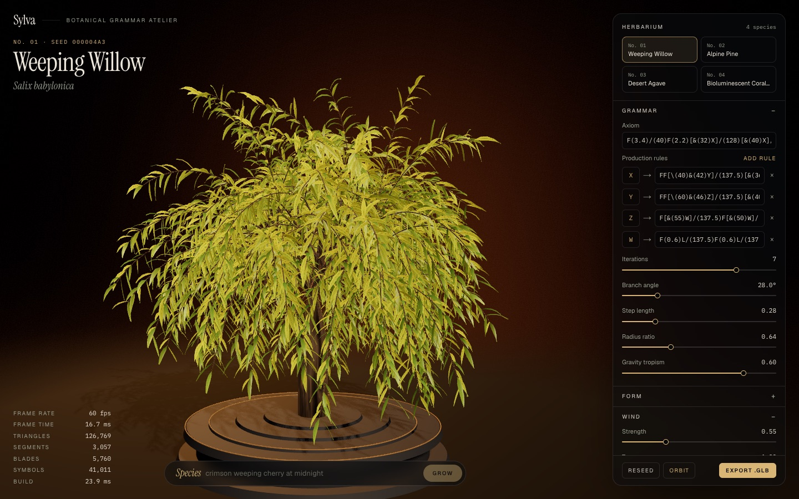
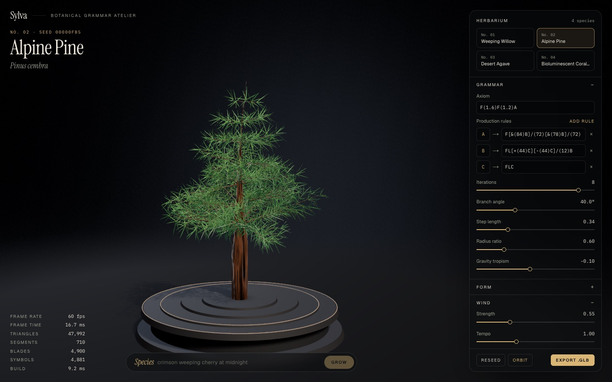

# Sylva

Sylva is an interactive atelier for growing plants from formal grammars. A bracketed L-system is expanded, walked by a 3D turtle, skinned into two batched meshes, and lit by custom GLSL wind and subsurface-scattering shaders on a gallery plinth. Describe a species in plain language to get a new grammar, tune it live, then export the specimen as a binary `.glb`.



| Alpine Pine | Desert Agave | Bioluminescent Coral Tree |
| --- | --- | --- |
|  |  |  |

## Getting started

```bash
npm install
npm run dev
```

Open `http://localhost:3000`. The Weeping Willow grows on load; the other presets live in the Herbarium at the top of the inspector.

| Script | Purpose |
| --- | --- |
| `npm run dev` | Development server with Turbopack |
| `npm run build` | Production build |
| `npm run start` | Serve the production build |
| `npm run typecheck` | `tsc --noEmit` under `strict` |

### Language model (optional)

The species prompt works without any credentials. To have a language model write the grammar, add a `.env.local` file:

```bash
OPENAI_API_KEY=sk-...
OPENAI_MODEL=gpt-5-mini
```

`OPENAI_MODEL` is optional. Without a key, or whenever the model call fails, the route falls back to the deterministic procedural generator, so the same description always grows the same plant.

## Using the atelier

- **Herbarium** switches between the four built-in species and replays the growth animation.
- **Grammar** edits the axiom and production rules as text, with sliders for iterations, default branch angle, step length, radius ratio and gravity tropism. Every edit rebuilds the mesh.
- **Form** covers trunk radius, per-depth length decay, angular jitter, leaf size and leaf shape.
- **Wind** sets strength, tempo, turbulence, heading and leaf flutter. **Light** selects a mood and adjusts leaf translucency, bark relief, bioluminescence and bloom.
- **Reseed** draws new random jitter, **Orbit** toggles the slow camera turn, and **Export .glb** downloads the current specimen.
- The **Species** bar at the bottom turns a description such as `crimson weeping cherry at midnight` into a grammar, palette and lighting mood.

Drag to orbit and scroll to zoom. The readout in the lower left shows live frame rate alongside the size of the current build.

## L-system syntax

A grammar is an axiom plus up to eight production rules. On each iteration every symbol that has a rule is replaced by its successor; symbols without rules are kept. Several rules for the same symbol are chosen between at random, seeded per specimen.

### Turtle alphabet

| Symbol | Meaning |
| --- | --- |
| `F` | Draw a branch segment one step long |
| `f` | Move one step without drawing |
| `+` `-` | Yaw left and right around the turtle's up axis |
| `&` `^` | Pitch down and up |
| `\` `/` | Roll left and right around the heading |
| `\|` | Turn around |
| `[` `]` | Push and pop the turtle state to start and finish a branch |
| `L` | Attach a leaf cluster at the current position |
| other letters | Growth buds that only matter through their rules |

Any symbol may carry a numeric argument in parentheses. `F(1.5)` scales that step by 1.5, `+(35)` and `/(137.5)` rotate by an explicit number of degrees instead of the default branch angle, and `L(0.6)` scales a leaf. When a symbol with an argument is rewritten, the whole module is replaced.

### Parameters

| Parameter | Effect |
| --- | --- |
| `iterations` | Number of rewriting passes, from 1 to 9 |
| `angleDeg` | Rotation used by `+ - & ^ \ /` when no argument is given |
| `stepLength` | Length of one `F` at bracket depth zero |
| `radiusScale` | Child-to-parent radius ratio at an even fork |
| `tropismGravity` | Positive values weep toward the ground, negative values reach upward |
| `lengthDecay` | Step multiplier applied once per bracket depth |
| `angleJitter` | Random variation applied to every rotation and step |

### Conventions worth knowing

- The turtle starts at the origin heading straight up. Rolling by `137.5` degrees between siblings gives natural phyllotaxis.
- Thickness is never written in the grammar. Radii follow a pipe model: each segment's radius is `trunkRadius * (downstreamLength / totalLength) ^ -log2(radiusScale)`, so trunks taper smoothly and limbs thin out at every fork.
- Deeper bracket levels respond more strongly to gravity, which lets a trunk stand straight while its whips hang.
- A rule with an empty successor erases its symbol. `L -> (empty)` keeps leaves on the youngest growth only, which is how the coral tree lights just its tips.
- A rule that rewrites `L` to itself drops the argument, so `L(0.55)` is a small newborn leaf that reaches full size one generation later. The agave rosette uses this.

### A worked example

The willow builds its scaffold in three staged symbols and then lets the whips lengthen for the remaining iterations, so raising `iterations` makes the curtain longer rather than denser:

```text
axiom  F(3.4)/(40)F(2.2)[&(32)X]/(128)[&(40)X]/(115)[&(28)X]/(131)[&(44)X]/(120)[&(10)X]
X  ->  FF[\(40)&(42)Y]/(137.5)[&(36)Y]/(110)[&(12)Y]
Y  ->  FF[\(60)&(46)Z]/(137.5)[&(40)Z]/(100)[&(14)Z]
Z  ->  F[&(55)W]/(137.5)F[&(50)W]/(137.5)F[&(45)W]/(137.5)[&(20)W]
W  ->  F(0.6)L/(137.5)F(0.6)L/(137.5)F(0.6)L/(137.5)F(0.6)LW
```

### Safety caps

Custom and generated grammars cannot stall the browser. Expansion stops before a sentence exceeds 180,000 symbols, the turtle stops at 26,000 segments, 14,000 leaf nodes or 48 nested brackets, and foliage is limited to 42,000 blades. When a cap is reached the last complete state is rendered and the readout reports that growth was capped. Grammars arriving from the API are also trimmed to an iteration count that stays well inside these limits.

## Rendering

### Geometry

The whole specimen is two draw calls, plus two more in the shadow pass.

- **Bark** is one indexed `BufferGeometry`. Consecutive segments share rings, the reference frame is parallel-transported along each limb to avoid twist, side counts fall from twelve on the trunk to four on twigs, and tips are capped. Attributes: `position`, `normal`, `uv` (around the limb, distance along it), `aBranchFactor` (0 at the root to 1 at flexible tips) and `aBarkRoughness` (1 on the trunk, lower on young wood).
- **Foliage** is one indexed `BufferGeometry` of curved, folded blades. Attributes: `position`, `normal`, `uv`, `aAnchor` (attachment point), `aSway` (per-vertex flutter weight), `aPhase`, `aBranchFactor` and `aShade` (canopy depth).

### Shaders

All sources live in `src/shaders` and are imported as text.

| File | Role |
| --- | --- |
| `wind.glsl` | Shared `windOffset(point, flex)`: a trunk lean weighted by height squared plus multi-octave limb eddies weighted by flexibility squared, so roots stay anchored |
| `bark.vert` | Applies wind and the growth reveal, which thickens limbs from the root outward |
| `bark.frag` | Cylinder-mapped plate and grain noise, derivative bump mapping, cavity shading, warm rim light and pulsing sap veins for luminous species |
| `foliage.vert` | Carries each blade with its branch by evaluating the same wind function at `aAnchor`, then adds flutter, twist and unfurling |
| `foliage.frag` | Vein and margin anatomy, wrapped diffuse light, and view-dependent transmission that brightens as the camera looks through a leaf toward a light |
| `lighting.glsl` | Shared key, back, hemisphere and rim light uniforms |
| `depth.frag` | Shadow pass companion so shadows sway with the plant |
| `backdrop.vert` `backdrop.frag` | Screen-space obsidian backdrop with a radial halo |

Frequently adjusted uniforms: `uWindStrength`, `uWindTime`, `uTurbulence`, `uWindDirection`, `uFlutter`, `uTranslucency`, `uBarkRelief`, `uGlow` and `uGrowth`. Light directions and colours come from the selected mood in `src/scene/moods.ts`, which also drives the Three.js lights on the plinth so both agree.

### Frame discipline

- No React state is set inside `useFrame`. Uniforms are written from `useBotanyStore.getState()`, and the frame-rate readout updates DOM text directly.
- Sylva's frame callbacks allocate nothing; scratch vectors live in the shared uniform objects.
- Geometries are disposed on every rebuild and materials on unmount. Live WebGL buffer, texture, program and framebuffer counts were checked to be unchanged after 48 parameter edits and six species switches.
- Measured in Chrome on an Apple M1 Max with vsync disabled, including the shadow pass, 4x MSAA and bloom: about 320 to 360 fps on a 2520x1575 canvas and about 580 fps at 1440x900 for every preset. Mesh builds take between 1 and 45 ms.

## Grammar API

`POST /api/grammar`

```json
{ "prompt": "towering crimson fern glowing at midnight" }
```

```json
{ "species": { "name": "...", "latin": "...", "grammar": {}, "form": {}, "palette": {}, "mood": "abyssal", "seed": 0 }, "source": "procedural" }
```

`source` is `openai` or `procedural`, and an optional `notice` explains a fallback. Model output is requested as a structured object, then repaired and clamped before it is trusted: sentences are reduced to well-formed modules with balanced brackets, numbers are clamped to slider ranges, colours are checked, and the result must pass the same Zod schema the client uses. The procedural generator matches the description against nine plant archetypes, reads colour, mood, stature and density words, and perturbs branching angles from a hash of the text.

## Export

**Export .glb** writes a binary glTF 2.0 file through `GLTFExporter` with a root node named after the species and two meshes, `Bark` and `Foliage`. Each carries positions, normals, UVs and baked vertex colours on a standard PBR material, with emission for luminous species. Coordinates are in scene units with Y up and are not rescaled to the stage. Exports of all four presets pass the Khronos glTF validator with no errors or warnings. Wind is a shader effect and is not part of the file.

## Project layout

```text
src/
  app/                 Next.js App Router shell and the /api/grammar route
  components/          Inspector, rule editor, prompt bar, placard and readout
  engine/
    lsystem.ts         Grammar expansion with symbol budget
    turtle.ts          3D turtle interpretation into a skeleton
    limbMetrics.ts     Pipe-model radii, flexibility and path lengths
    meshBuilder.ts     Batched bark geometry and build orchestration
    leafBuilder.ts     Batched blade geometry per leaf shape
    glbExporter.ts     Binary glTF export
    grammarSynth.ts    Deterministic description-to-species generator
    archetypes.ts      Plant archetypes used by the generator
    speciesNormalizer.ts  Repair and clamping of untrusted grammars
  scene/               Canvas, specimen, studio stage, moods and materials
  shaders/             GLSL sources
  store/               Zustand store
  types/               Zod schemas, types and species presets
```

## Stack

Next.js 16 with the App Router and React 19, TypeScript in strict mode, Three.js through React Three Fiber and Drei, `three-stdlib` for export, Tailwind CSS 4, Zustand, Zod, and the Vercel AI SDK with the OpenAI provider. The canvas is loaded client-side only.

## License

MIT. See [LICENSE](LICENSE).
